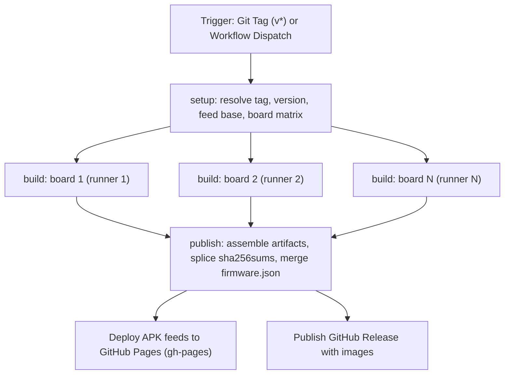

# GitHub Actions CI/CD Architecture & Workflow Guide

Comprehensive guide explaining the design, configuration, execution flow, automated packaging, and release deployment of the GitHub Actions CI/CD pipeline for **OpenWrt on Qualcomm MSM8916** devices.

---

## 1. System Overview & Architecture

The build pipeline automates the entire lifecycle of compiling OpenWrt firmwares, building modular kernel packages, deploying package repositories to GitHub Pages, and publishing GitHub Releases.



Each board gets its own runner, so the release is bounded by the slowest single board rather than
by the sum of all of them. The `publish` job is the only writer to the shared release state.

---

## 2. Workflow Specification (`.github/workflows/build-and-release.yml`)

The workflow definition is located at [`.github/workflows/build-and-release.yml`](../../.github/workflows/build-and-release.yml).
It is a three-stage pipeline:

```yaml
jobs:
  setup:    # resolve tag / version / feed base + the board matrix
  build:    # one runner per board, in parallel
  publish:  # assemble artifacts, publish the feed, cut the release
```

| Job | Runners | Purpose |
|-----|---------|---------|
| `setup` | 1 | Reads `version`, resolves the release tag, validates the `boards` input and emits it as a JSON matrix. A typo fails here in seconds instead of after a 30-minute build. |
| `build` | 1 per board | Builds exactly one board. All boards run concurrently, with `fail-fast: false` so one broken board does not cancel the others. |
| `publish` | 1 | Downloads the per-board artifacts, splices `sha256sums`, merges the manifest, publishes the feed and cuts the release. |

### Key Trigger Modes:
1. **Tag Push (`v*`)**: Pushing a tag like `v25.12.6-rc1` or `v25.12.6-r1` automatically executes the entire build and creates the corresponding release.
2. **Manual Dispatch (`workflow_dispatch`)**: Allows manual triggering from the GitHub Actions UI with a custom release tag and/or a subset of boards, without pushing new git commits.

### Concurrency

```yaml
concurrency:
  group: release-build
  cancel-in-progress: false
```

Releases are serialised on purpose: every run rewrites the shared `gh-pages` feed and the
shared `firmware.json` manifest, so two overlapping runs would clobber each other.
`cancel-in-progress` is **false** — a queued release waits its turn instead of being
silently discarded by a second dispatch.

---

## 3. Step-by-Step Pipeline Walkthrough

### Job `setup`

#### Step 1: Checkout Repository
- Uses `actions/checkout@v4`.

#### Step 2: Determine Release Tag, Version & Boards
- Takes the tag from the workflow input, else `${GITHUB_REF}` for a tag push, else derives it
  from the `version` file so a manual dispatch cannot publish `v25.12.6` for an r1 build.
- Reads `version` (`25.12.6-r4`) and computes `base` by stripping the `-rN` suffix.
  Devices point `CONFIG_VERSION_REPO` at `releases/<base>`, so that path must be published too.
- Expands the `boards` input into a JSON array. Empty means every `diffconfigs/*` entry;
  an unknown board name fails immediately with the list of valid ones.

### Job `build` (one per board)

#### Step 3: Checkout Repository
- Uses `actions/checkout@v4` with `fetch-depth: 0` to preserve the complete git history and tag metadata.

#### Step 4: Free Disk Space on Runner
- Removes pre-installed .NET runtimes, MySQL, PHP and the Android SDK to free ~35 GB, which a
  single-board build needs for `build_dir`.

#### Step 5: Restore OpenWrt Cache
- `actions/cache/restore@v4` — restore only. Eight parallel jobs must not each push a ~2 GB
  copy, so the single upload is done by the `first` board job (see step 8).

#### Step 6: Prepare OpenWrt Tree & Inject Signing Key
- Invokes `./build.sh prepare`, which builds the `devenv-builder` Docker image and runs
  `scripts/openwrt-prepare.sh`:
  - Clones and validates the OpenWrt source tree.
  - Syncs package feeds (`packages`, `luci`, `routing`, `telephony`, `video`) and verifies index files.
  - Installs the BSP into `target/linux/msm89xx` and links project packages into `package/msm8916/`.
  - Applies the tracked patches and compatibility fixes.
- Injects the persistent APK signing key: writes the `APK_SIGNING_KEY` secret to
  `openwrt/private-key.pem`. **The step fails hard if the secret is missing** — see §8.
  The key must be written *after* `prepare`: a fresh prepare clones the tree and would delete it.

#### Step 7: Build <board>
- Runs `./build.sh build <board>` inside the container: kernel (`boot.img`), SquashFS rootfs
  (`system.img`) and the sysupgrade archive (`sysupgrade.bin`).

#### Step 8: Compile Extra Packages (CUPS) — `first` board only
- Executes `make package/msm8916/cups/compile package/index V=s`.
- The package feed is target-wide, not board-specific, so building it once here avoids a separate
  job that would have to pay for a full `prepare` again.
- Compiles `cupsd`, the CUPS client tools, `kmod-usb-printer`, and re-signs `packages.adb`.

#### Step 9: Save OpenWrt Cache — `first` board only
- `actions/cache/save@v4`, skipped when the restore was already a hit.

#### Step 10: Upload Artifacts
- Every board uploads `board-<name>` with its images (`packages/` excluded, since it is identical
  for every board).
- The `first` board additionally uploads `feeds`: `bin/packages/aarch64_generic`,
  `bin/targets/msm89xx/msm8916/packages` and the derived `public-key.pem`.

### Job `publish`

#### Step 11: Download Board Images & Package Feed
- `actions/download-artifact@v4` reassembles every board into
  `openwrt/bin/targets/msm89xx/msm8916` and restores the feed into `openwrt/`.

#### Step 12: Attach the Frozen Recovery Images
- The rescue images are **frozen, not built**: they embed the WCNSS firmware and the calibrated
  wlan NV, which are git-ignored, so CI has nothing to build them from. They are re-attached
  unchanged from `v25.12.6-r4` (see §7.1 of the release runbook).

#### Step 13: Package Offline Kmod Bundle & Compute Checksums
- Bundles the target-compiled `.apk` packages into `kmods-msm8916-<version>.tar.gz`.
- Hashes every flashable image, the recovery images and the kmod archive. The globs run under
  `nullglob`: a targeted release leaves most patterns unmatched, and an unmatched glob would be
  passed through literally and make `sha256sum` fail.

#### Step 14: Merge Checksums With the Published `sha256sums`
- A targeted release builds a subset of the boards, so the fresh hashes cover only those. Publishing
  them as-is would strip the other boards' lines from the release. The step downloads the published
  `sha256sums`, replaces the rebuilt lines, keeps the rest and appends anything new. If the tag has
  no release yet, the fresh list is used verbatim.

#### Step 15: Generate `firmware.json` Manifest
- Merges into the currently published manifest so boards this run did not rebuild keep their entry.

#### Steps 16 & 17: Deploy Package Feeds to GitHub Pages
- Structures the web repository directory layout:
  ```text
  /releases/<version>/targets/msm89xx/msm8916/packages/
  /releases/<version>/packages/aarch64_generic/base/
  ```
- Deploys via `peaceiris/actions-gh-pages@v4` to the **`gh-pages`** branch with
  `keep_files: true` so prior versions are preserved.

#### Step 18: Prune Superseded Kernel & Kmod Packages
- The feed directory is additive — `keep_files: true` preserves anything the deploy does not
  mention — and every release adds another kernel generation with its own `kmod-*` set. Left alone
  it grows forever, and because `apk list -a` prints in index order rather than version order, a
  device could be told that its own kernel was missing from the feed.
- After the deploy, the job re-clones `gh-pages` and deletes every `kernel-*.apk` / `kmod-*.apk`
  that this build did not produce, in each release directory it published to. The index already
  lists only the current build, so the directory and the index stay in agreement.
- The push retries with a rebase, because the package publish workflows write to the same branch
  under their own concurrency groups.

#### Step 19: Publish GitHub Release
- Uses `softprops/action-gh-release@v2` with `prerelease: false` (a tag push `v*` publishes a full release).
- Attaches every image, `sha256sums`, the kmod bundle and the release notes. Assets with an existing
  name are replaced, so re-running a release is idempotent.

---

## 4. Release Artifacts Generated

| Artifact File | Description | Target Use Case |
| :--- | :--- | :--- |
| `*-squashfs-boot.img` | Android boot image (Kernel + DTB) | Fastboot / EDL flashing |
| `*-squashfs-system.img` | Read-only SquashFS rootfs image | Fastboot / EDL flashing |
| `*-squashfs-sysupgrade.bin` | Tarball archive with metadata | Web LuCI / CLI Sysupgrade |
| `*-firmware.zip` | Full firmware + partition script | Total unbricking / EDL recovery |
| `kmods-msm8916-<version>.tar.gz` | Offline archive of all target kmods | Offline package installation |
| `sha256sums` | Cryptographic verification hashes | Release file integrity checking |

---

## 5. Live Package Repository (GitHub Pages)

The workflow automatically serves an OpenWrt APK package repository over GitHub Pages:

### Feed URLs:
- **Target Drivers & Kmods**:
  `https://akbar-npj.github.io/msm8916-openwrt/releases/25.12.6/targets/msm89xx/msm8916/packages`
- **Base Architecture Packages**:
  `https://akbar-npj.github.io/msm8916-openwrt/releases/25.12.6/packages/aarch64_generic/base`

### On-Device Configuration:
Add these repositories to `/etc/apk/repositories.d/customfeeds.list`:
```text
https://akbar-npj.github.io/msm8916-openwrt/releases/25.12.6/targets/msm89xx/msm8916/packages
https://akbar-npj.github.io/msm8916-openwrt/releases/25.12.6/packages/aarch64_generic/base
```

Install packages over the air:
```bash
apk update
apk add cups-daemon cups-client kmod-sched-cake kmod-usb-printer kmod-bluetooth
```

### Hotfixing a single package (no firmware rebuild)

[`publish-package.yml`](../../.github/workflows/publish-package.yml) is a second,
narrowly scoped workflow: rebuild **one** package against the same toolchain and
kernel as the release, splice it into the published feed and re-sign the index.
The feed URL is unchanged, so no device needs a new repository line or a new key.

```bash
gh workflow run publish-package.yml --ref main -f package=msm89xx-scripts
# -> apk update && apk upgrade msm89xx-scripts   on the device
```

Inputs: `package` (required), `base` (default `./version` minus `-rN`), `board`
(default `hmuf02v5`; only matters for `kmod-*`, which are vermagic-locked) and
`bump` (default `true`, increments `PKG_RELEASE` — without it devices see the same
version and do nothing).

Two details matter for correctness:

1. **The published feed is downloaded first.** `make package/index` indexes
   whatever is in `openwrt/bin/packages`, so re-indexing a fresh tree would
   publish an index containing only the rebuilt package and every other package
   would vanish from `apk search`/`apk add`. The job restores `releases/<base>`
   from `gh-pages` into `openwrt/bin/` before building, then refuses to publish
   if the package count dropped.
2. **It re-signs with `APK_SIGNING_KEY`.** A missing secret is a hard failure —
   a per-build random key would make every device reject the feed with
   `UNTRUSTED signature`.

See [**Docs/Custom Packages → Shipping a package without a reflash**](../Custom%20Packages/README.md#shipping-a-package-without-a-reflash)
for the operational details and the traps.

### Rebuilding selected boards (targeted release)

`build-and-release.yml` accepts a `boards` input. When it is non-empty only those boards are
built, and the run still publishes the feed, merges the manifest and re-attaches the release
assets — so a rebuilt image never lands without the metadata that describes it.

```bash
gh workflow run build-and-release.yml --ref main \
  -f boards="uf02 uz801" -f release_tag="v25.12.6-r3"
```

Two things make a partial run safe:

1. **The manifest merge.** `firmware.json` is shared by all boards; the job downloads the published
   copy first and merges, so boards that were not rebuilt keep their entry instead of disappearing.
2. **The `sha256sums` splice.** The checksum file is merged the same way, so the release keeps
   the lines for every board, not just the two that were rebuilt.

`rebuild-boards.yml` used to do this by hand; it was folded into `build-and-release.yml` once the
splice moved into the pipeline, because its version skipped the feed and could leave an image
published with stale metadata.

## 6. How to Trigger & Replace Pre-Release Tags

When changes are merged into `main` and you want to trigger a fresh build and replace the pre-release tag:

```bash
# 1. Ensure local main is up-to-date
git checkout main
git pull origin main

# 2. Update the local tag to the latest commit
git tag -f v25.12.6-rc1

# 3. Force push the tag to GitHub to trigger the action
git push origin v25.12.6-rc1 --force
```

GitHub Actions will immediately pick up the tag update, compile all 4 boards, update the GitHub Pages feed, and overwrite the release assets with the newly compiled build.

---

## 7. Caching & Build Acceleration (actions/cache@v4)

To prevent recompiling host utilities, toolchains, and re-downloading upstream source packages from scratch on every run, the workflow leverages GitHub Actions caching:

### Cached Directories:
1. **`openwrt/dl` (~1.5 GB)**: Upstream tarballs and package repositories.
2. **`openwrt/staging_dir/toolchain-aarch64_generic_gcc-14.3.0_musl` (~2 GB)**: Compiled GCC 14 + musl cross-toolchain binaries.
3. **`openwrt/staging_dir/host` (~1 GB)**: Host build tools (cmake, meson, ninja, mkbootimg, etc.).

### Cache Configuration:
```yaml
- name: Restore OpenWrt Cache
  uses: actions/cache/restore@v4
  with:
    path: |
      openwrt/dl
      openwrt/staging_dir/toolchain-aarch64_generic_gcc-14.3.0_musl
      openwrt/staging_dir/host
    key: openwrt-cache-${{ needs.setup.outputs.version }}-${{ hashFiles('openwrt/feeds.conf.default', 'diffconfigs/hmuf02v5') }}
    restore-keys: |
      openwrt-cache-${{ needs.setup.outputs.version }}-${{ hashFiles('openwrt/feeds.conf.default', 'diffconfigs/hmuf02v5') }}-
      openwrt-cache-${{ needs.setup.outputs.version }}-
      openwrt-cache-
```

Three rules keep this affordable:

1. **No `${{ github.run_id }}` in the key.** A run-scoped key can never be restored, so every run
   saved a fresh ~2.3 GB copy. Four of those fill the 10 GB budget, entries get evicted, and later
   runs silently fall back to a stale prefix. The key is content-addressed instead.
2. **Restore-only in the matrix, save once.** Eight parallel jobs each pushing 2.3 GB would blow the
   budget in one run. `build` uses `actions/cache/restore`; only the `first` board job runs
   `actions/cache/save`.
3. **The hash input must exist.** An earlier key hashed `diffconfigs/hmu05`, a board that no longer
   exists — `hashFiles` silently returns an empty hash for a missing path, so the key was constant.

### Performance Impact:
- **First Build (Cold Cache)**: ~75 minutes.
- **Successive Builds (Warm Cache)**: the toolchain and `dl/` restore in a couple of minutes and the
  boards build in parallel, so wall-clock time is roughly one board's build rather than the sum.

---

## 8. Package Feed Signing Key (persistent + on-device self-heal)

OpenWrt's `apk` verifies the `packages.adb` index of every feed against a public key in `/etc/apk/keys/`. If no key on the device matches the key that signed the feed, `apk update` prints `UNTRUSTED signature` and skips the feed.

OpenWrt generates a **random key per build** unless `openwrt/private-key.pem` already exists (`openwrt/package/Makefile`, `BUILD_KEY_APK_SEC`). If the CI job lets that happen, every release is signed with a different ephemeral key, so a device flashed with release *N* rejects release *N+1*'s feed — and a locally-built image can never trust the CI feed.

### The persistent key

- **Repository secret:** `APK_SIGNING_KEY` holds the EC P-256 private key (PEM).
- **CI:** Step 4 writes it to `openwrt/private-key.pem` and **fails the build** if the secret is unset, so an ephemeral key can never be produced by accident again.
- **Image:** the matching public key is embedded at `/etc/apk/keys/akbar-npj-v25.12.6.pem` via `msm89xx/base-files/`, and re-created by `99-msm89xx-firstboot`.
- **Published:** the release job copies `openwrt/public-key.pem` both to the versioned dir and to the stable path:
  `https://akbar-npj.github.io/msm8916-openwrt/public-key.pem`

### On-device self-heal (`apk-key-refresh`)

`msm89xx/base-files/usr/sbin/apk-key-refresh` (driven by `/etc/init.d/apk-key-refresh`, enabled from `96-apk-key-refresh`) fetches the **stable URL** at every boot and installs it when it differs from the on-disk key. This lets a device flashed with an image that embedded a stale key recover without a reflash. The install is conservative: the fetched file must be a well-formed PEM public key, and the on-disk key is only rewritten when it actually changed (no overlay churn per boot).

> **Rotating the key:** generate a new EC P-256 key pair, update the `APK_SIGNING_KEY` secret, replace the tracked public key in `msm89xx/base-files/etc/apk/keys/akbar-npj-v25.12.6.pem` **and** the heredoc in `99-msm89xx-firstboot`, then cut a release. Devices on the previous image self-heal from the stable URL; devices on the new image carry the new key directly.

---

## 9. Kernel-Module (kmod) Feed — the curated "build-only" set

Kernel modules are **target-specific** (kernel version + config), so they are built into the *target* package directory, `openwrt/bin/targets/msm89xx/msm8916/packages/` — never the arch-generic `bin/packages/aarch64_generic/` tree. Because `msm89xx` is not an upstream OpenWrt target, there is **no upstream kmod feed** to fall back on: whatever this build does not compile simply cannot be installed.

By default OpenWrt only builds the kmods selected in the image plus their dependencies. That left the feed and the `kmods-msm8916-<version>.tar.gz` offline bundle **incomplete** — e.g. `kmod-usb-net-rtl8152` was not built at all, so `apk add kmod-usb-net-rtl8152` failed even though the README suggested it.

**Fix:** every `diffconfigs/<board>` appends a curated block of common USB/network kmods with

```text
CONFIG_PACKAGE_kmod-usb-net-rtl8152=m
```

The `=m` (build-only) value is the key: the module is **compiled and published into the feed**, but **not installed into the firmware image**. Users install it on demand with `apk add <name>`.

- **Feed:** `…/releases/<version>/targets/msm89xx/msm8916/packages/`
- **Offline bundle:** `kmods-msm8916-<version>.tar.gz` (a `tar` of that same directory — the two are always identical)

### Why not `CONFIG_ALL_KMODS`

`CONFIG_ALL_KMODS=y` would compile *every* kmod, but each kmod package `select`s its kernel dependencies, so it also forces ~227 extra **built-in** (`=y`) subsystems into the shipping kernel (cgroups/MEMCG, media/DVB/V4L2, DRM + framebuffer console, MPTCP, NFSD, …). That is a heavy change to a firmware whose kernel is deliberately tuned for this device (CPR rail, thermal, modem). The curated set pulls in only modest USB/network/storage subsystems and keeps the kernel lean.

To extend the feed, add more `CONFIG_PACKAGE_kmod-<name>=m` lines to `diffconfigs/<board>`. To confirm a module is published, check for `kmod-<name>-*.apk` under `packages/`.

> **Note:** the kmods tarball and the online feed are produced from the *same* directory in the same job, so they can never drift. A kmod is vermagic-bound to the kernel it was built against, so a module in this feed only loads on this exact kernel build.

