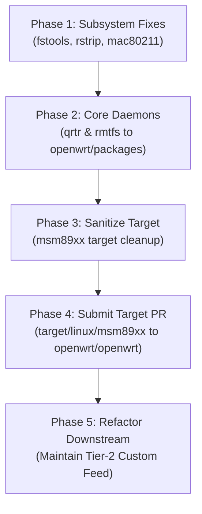

# Upstream OpenWrt Integration Strategy

*A roadmap for merging Qualcomm Snapdragon 410 (MSM8916/MSM89xx) hardware support into official upstream OpenWrt while preserving the downstream community experience.*

---

## 1. Executive Summary

This repository (`msm8916-openwrt`) is not a thin fork of OpenWrt; it is a **comprehensive, opinionated downstream distribution** tailored for 4G LTE USB dongles and pocket routers. It combines:

1. **Architecture & Target code**: `target/linux/msm89xx` (SoC enablement, Linux 6.12, device trees, image recipes).
2. **Kernel driver improvements**: Mainline CPR, BAM-DMUX stability patches, PM8916 battery gauges, TSENS deferral.
3. **Core subsystem backports & fixes**: Qualcomm WCN36xx Wi-Fi (WPA3-SAE, concurrent AP+STA), `fstools`, `rstrip.sh`.
4. **Userspace daemons & libraries**: `qrtr`, `rmtfs`, `libqmi` patches, BlueZ SPP tools.
5. **Turnkey product customizations**: Feelgood theme, custom SMS manager, battery monitor, APK OTA signing keys, failsafe/recovery partition helpers, and an opinionated selection of 100+ default packages.

Attempting to submit this repository as a single monolithic pull request to `openwrt/openwrt.git` will result in **immediate rejection**. OpenWrt maintainers mandate:
* Strict modularity across distinct upstream repositories (`openwrt.git`, `packages.git`, `luci.git`).
* Minimal `DEFAULT_PACKAGES` (only what hardware strictly requires to boot and provide networking).
* **Zero opaque binary blobs** checked into target source trees.
* Strict POSIX `ash` shell execution for early preinit and `sysupgrade` (no `/bin/bash` dependency).
* Atomic git commits with proper subsystem prefixes and `Signed-off-by` lines.

To successfully merge your work, you must execute a **Decomposition & Upstreaming Strategy** based on the **Two-Tier Architecture**.

---

## 2. The Two-Tier Architecture Model

Major commercial and community OpenWrt downstream projects (such as GL.iNet, Teltonika, Turris, and FriendlyWrt) maintain a clean two-tier separation:

```
┌────────────────────────────────────────────────────────────────────────┐
│                   Tier 1: Upstream OpenWrt (Official)                   │
│                                                                        │
│  [openwrt/openwrt.git]         [openwrt/packages.git]                  │
│  ├── target/linux/msm89xx/      ├── utils/qrtr                         │
│  ├── mac80211 wcn36xx patches   └── utils/rmtfs                        │
│  └── core fixes (fstools, etc.)                                        │
└───────────────────────────────────┬────────────────────────────────────┘
                                    │ pulls in / builds on top
┌───────────────────────────────────▼────────────────────────────────────┐
│              Tier 2: Community Flavor / Custom Feed (Downstream)        │
│                                                                        │
│  ├── Package Feed: luci-app-sms-manager, luci-theme-feelgood           │
│  ├── Hardware Flasher: flash.sh, generate_squashfs_gpt.sh              │
│  ├── Proprietary / Extraction helpers: msm-firmware-dumper, diag-nv    │
│  └── Turnkey Profiles: Tailscale, Zerotier, BBR defaults, custom keys  │
└────────────────────────────────────────────────────────────────────────┘
```

* **Tier 1 (Upstream OpenWrt)**: Focuses purely on SoC enablement, device trees, kernel stability, and base sysupgrade. Once merged, OpenWrt buildbots produce official snapshot and release images for MSM8916 devices.
* **Tier 2 (This Repository)**: Becomes a dedicated community layer / external package feed that users or image builders overlay on top of official OpenWrt to obtain the specialized dongle experience.

---

## 3. Component Triaging Matrix

Every component in this repository maps to a specific upstream destination or must remain downstream:

| Path in Repository | What it is | Upstream Destination | Required Action Before Submission |
| :--- | :--- | :--- | :--- |
| `msm89xx/` | Target definition, `config-6.12`, subtarget `msm8916` | `openwrt/openwrt.git` (`target/linux/msm89xx`) | Prune `DEFAULT_PACKAGES`, remove `diag_nv.bin`, remove bash dependency from `platform.sh`. |
| `msm89xx/patches/` | Kernel driver & DTS patches | `openwrt/openwrt.git` (`target/linux/msm89xx/patches`) | Clean up headers, add `Signed-off-by`, refresh using `make target/linux/refresh`. |
| `openwrt-overlay/.../mac80211/` | WCN36xx driver patches (WPA3, concurrency) | `openwrt/openwrt.git` (`package/kernel/mac80211`) | Submit as dedicated Wi-Fi PR; ideally push driver fixes to `linux-wireless` mailing list. |
| `openwrt-patches/0001-package-pack...` | `include/package-pack.mk` IDIR fix | `openwrt/openwrt.git` | Submit as small standalone PR with clear commit justification. |
| `openwrt-patches/810-rstrip...` | Skip stripping carrier MBN files | `openwrt/openwrt.git` (`scripts/rstrip.sh`) | Submit as independent build-system PR. |
| `openwrt-patches/811-wifi-sta...` | `netifd` wireless scripts STA guard | `openwrt/openwrt.git` (`package/network/config/wifi-scripts`) | Propose as clean netifd mac80211 script enhancement. |
| `openwrt-overlay/.../fstools/` | `0001-block-skip-nonexistent-fstab...` | `openwrt/openwrt.git` or `openwrt/fstools.git` | Submit as clean bugfix PR. |
| `packages/qrtr` | Qualcomm IPC Router daemon & library | `openwrt/packages.git` (`utils/qrtr`) | Standardize Makefile with OpenWrt package guidelines. |
| `packages/rmtfs` | Qualcomm Remote Filesystem daemon | `openwrt/packages.git` (`utils/rmtfs`) | Add init script, verify BSD-3-Clause license, submit PR to `packages.git`. |
| `packages/luci-app-sms-manager` | SMS Web GUI | `openwrt/luci.git` OR Custom Feed | Can be submitted to LuCI feed if decoupled from target-specific paths. |
| `packages/luci-app-battery` | PM8916 Battery Web GUI | `openwrt/luci.git` OR Custom Feed | Can be submitted to LuCI feed. |
| `packages/luci-theme-feelgood` | Custom Feelgood theme | **Keep Downstream** | Upstream LuCI rejects vendor themes; distribute via community feed. |
| `msm89xx/base-files/.../diag_nv.bin` | Precompiled 64-bit ELF utility | **Keep Downstream** | Never submit binaries. If required, provide open-source C source with `Makefile`. |
| `msm89xx/base-files/.../apk/` | Custom APK signing keys & repo lists | **Keep Downstream** | Upstream OpenWrt uses its own official package signing keys and repos. |

---

## 4. Phased Upstreaming Roadmap

Follow these 4 phases in order. Early phases build maintainer trust, making the final target review much smoother.



---

### Phase 1: Core Subsystem Pull Requests (Fast Wins)

Submit standalone, atomic PRs against `openwrt/openwrt.git` for general bugfixes:

1. **`fstools` fstab handling**:
   * File: `openwrt-overlay/package/system/fstools/patches/0001-block-skip-nonexistent-fstab-in-config-try-load.patch`
   * Commit Subject: `fstools: skip nonexistent fstab in config_try_load`
   * Explain the edge-case where missing `/etc/config/fstab` causes unnecessary failure during preinit.

2. **`rstrip.sh` carrier MBN protection**:
   * File: `openwrt-patches/810-rstrip-skip-carrier-mcfg.patch`
   * Commit Subject: `scripts/rstrip.sh: do not strip Qualcomm carrier configuration MBN files`
   * Explain that ELF stripping damages Qualcomm carrier MBN binaries during package installation.

3. **`mac80211` / `wcn36xx` driver patches**:
   * Files in: `openwrt-overlay/package/kernel/mac80211/patches/ath/`
   * Specifically:
     * `450-wcn36xx-only-send-mc-list-when-sta-associated.patch`
     * `451-wcn36xx-mfp-wpa3.patch`
     * `452-wcn36xx-iface-combinations.patch`
     * `458-wcn36xx-bmps-concurrency-guard.patch`
     * `459-wcn36xx-rx-survey-null-band.patch`
   * Note: Maintainers will ask if these patches are accepted upstream in the Linux kernel (`linux-wireless`). If they are backports from mainline or `wireless-next`, mention the upstream commit hash. If they are custom bugfixes, format them cleanly with full explanation.

---

### Phase 2: Upstream Qualcomm Daemons to `openwrt/packages.git`

The `msm89xx` target requires `qrtr` and `rmtfs` to access baseband firmware and modem partitions. Upstream OpenWrt does not keep these in the core repository; they belong in the `packages` feed.

1. Fork `https://github.com/openwrt/packages`.
2. Add package directories:
   * `utils/qrtr`: Cleaned up version of [`packages/qrtr`](file:///home/shaanair/Projects/msm8916-openwrt-clean/packages/qrtr).
   * `utils/rmtfs`: Cleaned up version of [`packages/rmtfs`](file:///home/shaanair/Projects/msm8916-openwrt-clean/packages/rmtfs).
3. Validate:
   * Packages must build using standard `rules.mk` and `package.mk`.
   * Check licenses (`BSD-3-Clause`), maintainer fields, and init scripts.
4. Open PRs on `openwrt/packages` targeting `master`.

---

### Phase 3: Sanitizing `target/linux/msm89xx`

Before opening the target pull request, the target directory must be cleansed of all downstream product customizations.

#### 1. Prune `msm89xx/Makefile` `DEFAULT_PACKAGES`
Upstream targets must only select packages required to boot and connect. 
* **Remove**:
  `avahi-dbus-daemon`, `bluez-*`, `bt-*`, `cups`, `luci*`, `nano`, `strace`, `tailscale`, `zerotier`, `zram-swap`, `kmod-sched-bbr`, etc.
* **Keep strictly minimal**:
  ```makefile
  DEFAULT_PACKAGES += \
      kmod-usb-chipidea kmod-usb-gadget-eth \
      kmod-wcn36xx kmod-qcom-rproc-wcnss kmod-qcom-rproc \
      kmod-rpmsg-wwan-ctrl kmod-bam-dmux kmod-qcom-rproc-modem \
      kmod-gpio-button-hotplug \
      rmtfs qrtr-utils partx-utils e2fsprogs f2fs-tools
  ```

#### 2. Clean `msm89xx/base-files/`
* **Delete binary blob**:
  ```bash
  rm -f msm89xx/base-files/usr/libexec/diag_nv.bin
  ```
  *(If diag NV access is required, write an open-source tool built from source via package Makefile).*
* **Delete downstream keys & feeds**:
  ```bash
  rm -rf msm89xx/base-files/etc/apk/
  ```
* **Remove LuCI controller hooks from target base-files**:
  Remove `usr/lib/lua/luci/controller/reboot-modes.lua` and related `.htm` templates. Target base-files must never assume LuCI is installed.
* **Purge Bash dependency from `lib/upgrade/platform.sh`**:
  OpenWrt preinit and sysupgrade run under BusyBox `ash`. Remove `/bin/bash` calls and `platform.bash`. The upgrade script must be 100% POSIX `/bin/sh` compliant.

#### 3. Normalize Device Definitions (`image/msm8916.mk`)
* Ensure device definitions strictly use OpenWrt's device macros:
  ```makefile
  define Device/generic-ufi001b
    $(Device/msm8916)
    DEVICE_VENDOR := Generic
    DEVICE_MODEL := UFI001B
    DEVICE_DTS := msm8916-generic-ufi001b
    SUPPORTED_DEVICES := ufi001b,250605v0s
    DEVICE_PACKAGES := wpad-basic-wolfssl uci-usb-gadget
  endef
  TARGET_DEVICES += generic-ufi001b
  ```
* Remove proprietary recovery generation scripts from the standard build pipeline unless implemented through standard OpenWrt `IMAGE/...` rules.

#### 4. Refresh Kernel Config & Patches
Target OpenWrt `main` (which uses Linux 6.12 or current development kernel).
```bash
# In your OpenWrt checkout
make target/linux/msm89xx/refresh V=s
```
Verify that every patch in `msm89xx/patches/` has:
1. Standard header (`From ...`, `Subject: [PATCH] ...`)
2. Explanation of problem and solution
3. `Signed-off-by: Real Name <email>`

---

### Phase 4: Git Submission Workflow

1. **Fork and checkout `main`**:
   ```bash
   git clone https://github.com/openwrt/openwrt.git upstream-openwrt
   cd upstream-openwrt
   git checkout -b target-msm89xx origin/main
   ```
   *(Always target `main`. OpenWrt never accepts new targets directly into stable release branches like 24.10 or 25.12).*

2. **Copy cleaned target directory**:
   ```bash
   cp -a /path/to/msm8916-openwrt-clean/msm89xx target/linux/msm89xx
   ```

3. **Check commit rules**:
   Commit subject:
   `target/linux/msm89xx: add Qualcomm Snapdragon 410 (MSM8916) support`

   Commit body:
   * Hardware description (Snapdragon 410 / MSM8916 quad-core Cortex-A53).
   * List of supported boards (UZ801, UFI001B, UFI003, HMUF02, MF800B, MIFIB-V12).
   * Confirmation of tested features (Boot, eMMC rootfs, USB gadget networking, Wi-Fi AP/STA, LTE modem data call, Sysupgrade).
   * Mandatory line: `Signed-off-by: Your Name <your.email@example.com>`.

4. **Verify build from scratch**:
   ```bash
   make defconfig
   make target/linux/msm89xx/compile -j$(nproc) V=s
   ```

5. **Submit Pull Request**:
   * Open the PR on GitHub against `openwrt/openwrt:main`.
   * Engage actively with maintainer review comments.

---

### Phase 5: Re-architecting Downstream as an Overlay Feed

Once the upstream PR is accepted, transform this repository (`msm8916-openwrt`) into a **community flavor**:

1. **Target tracking**:
   Instead of carrying `msm89xx/` out-of-tree, your repository uses upstream OpenWrt as its base.
2. **Dedicated package feed (`msm8916-feed`)**:
   Keep packages like:
   * `luci-theme-feelgood`
   * `luci-app-sms-manager`
   * `luci-app-battery`
   * `luci-app-wifi-sta`
   * `diag-efs`, `diag-logtool`, `msm-firmware-dumper`
   * `qcom-carrier-autocfg`
3. **Downstream Profile / Diffconfig**:
   Use `diffconfig` to pre-select BBR, Tailscale, BlueZ, and the Feelgood theme for users who want the "turnkey" modem stick experience.

---

## 5. Upstream Readiness Checklist

Before publishing your target Pull Request, audit against this checklist:

- [ ] **No binary files**: `git log --stat` contains no `.bin`, `.elf`, `.tar`, or proprietary archives.
- [ ] **No proprietary keys**: Base-files contain no custom APK/OPKG signing keys.
- [ ] **No Bash in base-files**: `platform.sh` and preinit scripts execute cleanly under `ash`.
- [ ] **Minimal default packages**: `msm89xx/Makefile` does not bundle custom themes, CLI editors, or non-essential network services.
- [ ] **Kernel config refreshed**: `config-6.12` contains no invalid/unresolved symbols.
- [ ] **All patches documented**: Every file in `patches/` has a commit header and `Signed-off-by`.
- [ ] **Sysupgrade verified**: Upgrading from image to image preserves `/etc/config` and completes cleanly via CLI.
- [ ] **Clean git history**: Commits are atomic and rebased cleanly against `origin/main`.

---

## 6. References & Related Documentation

* [Architecture Overview](file:///home/shaanair/Projects/msm8916-openwrt-clean/Docs/ARCHITECTURE.md)
* [Patches and Packaging Map](file:///home/shaanair/Projects/msm8916-openwrt-clean/Docs/PATCHES_AND_PACKAGING.md)
* [Adding a Device Board](file:///home/shaanair/Projects/msm8916-openwrt-clean/Docs/ADDING_A_DEVICE_BOARD.md)
* [Sysupgrade Internals](file:///home/shaanair/Projects/msm8916-openwrt-clean/Docs/Sysupgrade/)
* [OpenWrt Submitting Patches Guide](https://openwrt.org/submitting-patches)
